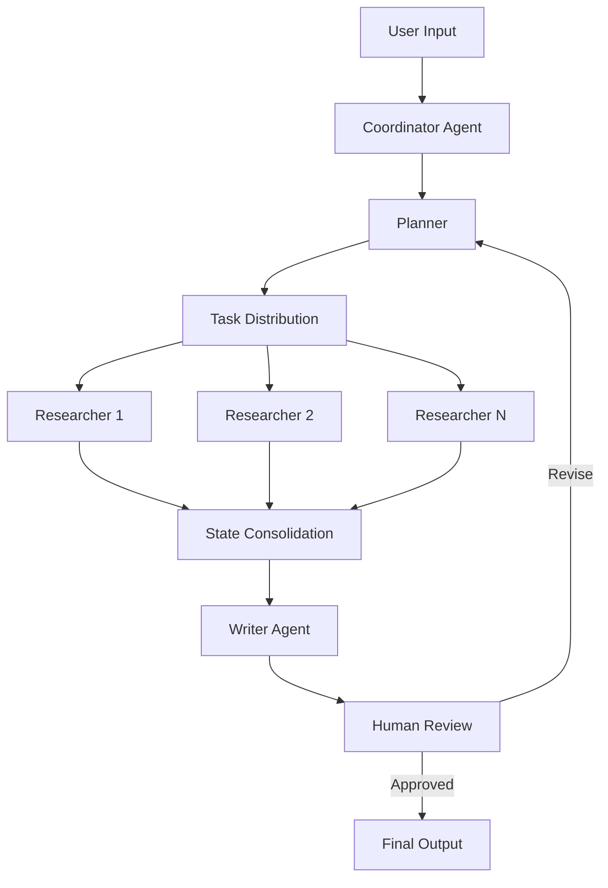

# 👋 Hi, I'm Ricky

<div align="center">

### 🚀 Senior Python Engineer | AI Agent Architect | LangGraph Expert

*Building intelligent systems that think, plan, and execute*

[](https://www.python.org/)
[](https://www.langchain.com/)
[](https://fastapi.tiangolo.com/)
[](https://www.docker.com/)

</div>

---

## 🎯 About Me

I specialize in architecting and developing **multi-agent AI systems** using cutting-edge frameworks like **LangGraph** and **LangChain**. My work focuses on transforming complex workflows into intelligent, autonomous systems that can plan, execute, and adapt.

```python
class Ricky:
    def __init__(self):
        self.role = "Senior Python Engineer"
        self.focus = ["AI Agents", "LangGraph", "Multi-Agent Systems"]
        self.current_projects = [
            "Intelligent Report Generation Systems",
            "AI Writing Assistants",
            "Document Processing Workflows",
            "Plan-Execute-Replan Architectures"
        ]
    
    def expertise(self):
        return {
            "frameworks": ["LangGraph", "LangChain", "FastAPI", "Pydantic"],
            "specialties": [
                "Multi-agent orchestration",
                "Parallel execution workflows",
                "Human-in-the-loop systems",
                "Real-time streaming interfaces",
                "Complex state management"
            ],
            "architecture": [
                "Plan-Execute architectures",
                "Coordinator-Worker patterns",
                "Subgraph orchestration",
                "Event-driven systems"
            ]
        }
```

---

## 💡 Core Expertise

### 🤖 AI Agent Development
- **Multi-Agent Systems**: Coordinator, Planner, Researcher, Writer agents working in harmony
- **LangGraph Orchestration**: Complex state graphs with parallel execution and dynamic routing
- **Human-in-the-Loop**: Interrupt handling and human review checkpoints
- **Streaming Interfaces**: Real-time SSE streaming for workflow visualization

### ⚡ Technical Stack

#### **Languages & Frameworks**


#### **Infrastructure & Tools**


#### **Key Libraries**
- **AI/ML**: Pydantic, Matplotlib, NumPy, Pandas
- **Web**: FastAPI, SSE (Server-Sent Events), Async I/O
- **Document Processing**: HTML/Markdown conversion, PDF handling
- **Visualization**: Chinese font rendering, Chart generation

---

## 🏗️ Architecture Patterns I Love



### 🎨 Design Philosophy
- **Clean Architecture**: Separation between AI intelligence and user interaction
- **Production-Ready**: Robust error handling and scalability from day one
- **Maintainable Code**: Clear structures over complex but fragile implementations
- **Root Cause Focus**: Deep analysis over superficial fixes

---

## 🔥 Current Focus

- 🎯 Optimizing parallel execution in LangGraph subgraphs
- 🔄 Building sophisticated plan-execute-replan architectures
- 🌊 Implementing real-time streaming for complex workflows
- 🎨 Perfecting Chinese font rendering in data visualizations
- 🤝 Designing intuitive human-in-the-loop interfaces

---

## 📚 Recent Challenges Conquered

- ✅ SSE streaming display optimization for multi-agent workflows
- ✅ Parallel subgraph execution with proper state management
- ✅ Interrupt handling for human review checkpoints
- ✅ Docker timeout resolution in complex pipelines
- ✅ Concurrent state updates across parallel research tasks
- ✅ Chinese font rendering in matplotlib visualizations

---

## 🌟 Featured Projects

### 🤖 Intelligent Report Generation System
Multi-agent system with coordinator, planner, researchers, and writers orchestrated through LangGraph for automated report generation with human review checkpoints.

**Tech Stack**: LangGraph, FastAPI, SSE Streaming, Pydantic  
**Features**: Plan-execute-replan architecture, parallel research, real-time updates

### ✍️ AI Writing Assistant
Advanced writing agent with prompt engineering optimization and structured output generation for various content types.

**Tech Stack**: LangChain, LangGraph, Pydantic Models  
**Features**: Context-aware writing, style adaptation, multi-format output

### 📊 Document Processing Workflows
Complex document analysis and transformation pipelines with HTML/Markdown conversion and data visualization.

**Tech Stack**: Python, Matplotlib, Custom parsers  
**Features**: Format conversion, chart generation, Chinese font support

---

## 💭 Beyond Code

When I'm not architecting AI systems, I explore:
- 🌍 Geopolitics & international relations
- 🎖️ Military technology & strategy
- 📈 Economics & market dynamics
- 📜 Chinese history & culture
- 🧠 Evidence-based decision making

---

## 📫 Let's Connect

I'm always interested in discussing:
- 🤖 Advanced AI agent architectures
- 🔗 LangGraph optimization techniques
- 🏗️ System design for multi-agent workflows
- 🚀 Production-ready AI implementations

---

<div align="center">

### ⚡ "Clean architecture beats clever code every time" ⚡

**Building the future of autonomous AI systems, one graph at a time**


</div>
